# dsh-redline

English · [Português (Brasil)](README.pt-BR.md) · [简体中文](README.zh-CN.md)

[](https://www.npmjs.com/package/dsh-redline) [](https://www.npmjs.com/package/dsh-redline) [](LICENSE) [](https://github.com/klaus-2/dsh-redline/releases) [](https://github.com/klaus-2/dsh-redline/discussions)

**Point at any element on the page. Your agent fixes the code.**

`dsh-redline` is a [DeepSeek Harness](https://github.com/deepseek-ai/deepseek-harness) plugin that puts visual review inside the harness browser: select an element, leave a comment, adjust styles live, and confirm — the annotations travel to your agent as structured context attached to your next message, with a cropped screenshot of exactly the region you marked.

`dsh plugin --profile web add dsh-redline`

---

## Why this exists

Describing a UI problem in words loses the pointer. "The button in the middle section looks off" makes your agent guess. Redline keeps the feedback attached to the element: selector, role, text, your comment, a cropped screenshot, and every style tweak you tried — delivered in one structured block the agent can act on.

## Product tour



1. Press **C** (comment) or **V** (adjust) in any page opened in the harness browser.
2. Click an element. A popover opens anchored to it.
3. Write the comment, or open the inspector and adjust text, colors, typography, size, spacing, borders and effects — every change previews live on the page.
4. Confirm. The card above the composer collects your pins. Send, and the annotations reach the agent as a snapshot alongside your message — rendered natively in the chat.
5. Press **D** for the free annotation canvas: brush, lines, arrows, rectangles, ellipses, numbered step markers and text — send the full page to the chat with every drawing composited into the screenshot.

## What the agent receives

For each pin, one block in a single snapshot:

- `Target` — tag, role, accessible label
- `Target selector` — a CSS path back to the element
- `Target text` / `Component` — content and framework hints
- `Screenshot (cropped around the target)` — a JPEG of the marked region with surrounding context
- `Comment` — what you asked for
- `Requested visual changes` — every live adjustment as `prop: before -> after`
- `Requested text change` — when you edited the element's text

## Features

- Element picking with hover highlight on any page the harness browser renders
- Per-pin comments, editable in place, with resolve/reopen/delete
- Live style inspector with rollback: drag-to-scrub numbers, color pickers, presets, linked box-model and radius edits, shadow and transform composers, per-row reset
- Cropped screenshots per pin (not the whole viewport)
- Annotations attach to the next message of the session you are viewing, rendered as a native chat card
- Reconciliation: removing a pin from the card removes it from the page overlay too
- English, Português (Brasil) and 简体中文 in the overlay UI, chosen from the browser locale

## Install

```bash
dsh plugin --profile web add dsh-redline
dsh web
```

For a private or unreleased build, install from a git URL or a local path:

```bash
dsh plugin --profile web add git+https://github.com/klaus-2/dsh-redline.git
dsh plugin --profile web add ./dsh-redline
```

## Use

| Key | Action |
| --- | --- |
| `C` | Comment mode — pick an element, write what should change |
| `V` | Adjust mode — pick an element, open the live style inspector |
| `Esc` | Cancel the current mode, popover or preview |
| `Enter` | Save the annotation from the popover |

Pins collect in the card above the composer. **Send** dispatches them with your next message; the ✕ discards them, and the page overlay updates itself.

## Security notes

The loopback server binds to 127.0.0.1 only, answers only for its own host names (so a name that resolves to 127.0.0.1 cannot reach it) and validates the Host header, so remote origins cannot reach it. Every private route requires an instance secret that the host keeps in the profile (`~/.dsh/profiles/<profile>/dsh-redline/instance.secret`, mode 0600) and that never reaches the page: the overlay holds no secret, no header and no secret in a URL.

The page talks to the host through a limited message bridge instead. It can submit the annotations, save the drawings, read the narrow state the overlay draws (language, delivery, pending ids, settings) and report a diagnostic — every other route answers `401`. The host half calls the bridge with the secret; the page calls it from a browser request that carries this origin, and the `Origin` header cannot be forged by a script. That origin also carries the pages the plugin proxies, so the bridge is an annotation channel and never a data channel.

Pages running in the harness browser can submit annotations by design — that is the plugin working as intended, so treat comments arriving through Redline like any other user-authored input: a comment is the text the Redline overlay captured on the page, and the pending annotations are shown in the card above the composer before they attach to your next message. The agent ticker (tool arguments, agent text) stays in the host; the page only ever sees the narrow projection above. No cookies are forwarded through the proxy.

## Configure

Nothing to configure by default. The plugin starts a loopback server (`127.0.0.1:47477`, falling back to the next 20 ports) that serves the overlay, the screenshot attachments and the annotation intake.

## How it works

The client face injects the overlay into every page the harness browser renders. The overlay sends the annotations through the message bridge, and the loopback server stores a pending snapshot keyed by the session you are viewing. When you send a message, the host attaches the snapshot to the agent's turn as a producer-owned context message with section metadata, and the chat renders it as a collapsible card.

## Develop

```bash
npm install
npm run build
npm test
npm run strip-comments
```

`overlay.template.js` + `tencil-overlay.css` are the sources; `lib/overlay.js` is generated — never edit it directly. `tools/smoke.mjs` runs 33 checks (proxy, rewrite, intake, screenshots, context format, overlay integrity) against an isolated port.

## Scope

One harness instance, pages rendered by its built-in browser, viewport-based crops. Remote browsers and full-page capture are out of scope for now.

## Credits

### Contains code from

- **[tencil](https://tencil.dev/)** — the overlay design system in
  `tencil-overlay.css` is derived from tencil's overlay sources
  (Copyright 2026 Pixel Perfect Agency, licensed under Apache-2.0 and
  modified: accent palette, comment removal, inspector additions).
  Full notice: [THIRD-PARTY-NOTICES.md](THIRD-PARTY-NOTICES.md).

- **[html2canvas](https://html2canvas.hertzen.com/)** — `vendor/html2canvas.min.js`
  bundles version 1.4.1 (Copyright 2022 Niklas von Hertzen, MIT) to render
  screenshot crops without any install-time dependency.
  Full notice: [THIRD-PARTY-NOTICES.md](THIRD-PARTY-NOTICES.md).

### Inspired by

- **[dsh-web-review](https://github.com/CanglongCl/dsh-web-review)** —
  the delivery loop (annotations attaching to the agent's next message).
- **[dsh-annotate](https://github.com/BrambleXu/dsh-annotate)** —
  the structured browser-facts shape and the update-check pattern.

## License

[MIT](LICENSE)
