# dsh-redline

[English](README.md) · Português (Brasil) · [简体中文](README.zh-CN.md)

[](https://www.npmjs.com/package/dsh-redline) [](https://www.npmjs.com/package/dsh-redline) [](LICENSE) [](https://github.com/klaus-2/dsh-redline/releases) [](https://github.com/klaus-2/dsh-redline/discussions)

**Aponte para qualquer elemento da página. Seu agente corrige o código.**

`dsh-redline` é um plugin do [DeepSeek Harness](https://github.com/deepseek-ai/deepseek-harness) que traz a revisão visual para dentro do navegador do harness: selecione um elemento, escreva um comentário, ajuste estilos ao vivo e confirme — as anotações chegam ao agente como contexto estruturado anexado à sua próxima mensagem, com um recorte de screenshot exatamente da região marcada.

```
dsh plugin --profile web add dsh-redline
```

## Por que existe

Descrever um problema de UI em palavras perde o ponteiro. "O botão da seção do meio parece errado" faz o seu agente adivinhar. O Redline mantém o feedback ligado ao elemento: seletor, role, texto, seu comentário, uma screenshot recortada e cada ajuste de estilo que você tentou — entregues em um único bloco estruturado que o agente pode acionar.

## Como usar



1. Em qualquer página aberta no navegador do harness, pressione **C** (comentário) ou **V** (ajuste).
2. Clique em um elemento. Um popover abre ancorado nele.
3. Escreva o comentário ou abra o inspetor e ajuste texto, cores, tipografia, tamanho, espaçamento, bordas e efeitos — cada mudança faz preview ao vivo na página.
4. Confirme. O card acima do composer coleta seus pins. Envie e as anotações chegam ao agente como snapshot junto da sua mensagem — renderizadas nativamente no chat.
5. Pressione **D** para o canvas livre de anotações: pincel, linhas, setas, retângulos, elipses, marcadores de etapas numeradas e texto — envie a página inteira ao chat com cada desenho composto na captura.

## O que o agente recebe

Para cada pin, um bloco em um único snapshot:

- `Target` — tag, role, rótulo acessível
- `Target selector` — um caminho CSS de volta ao elemento
- `Target text` / `Component` — conteúdo e dicas de framework
- `Screenshot (cropped around the target)` — um JPEG da região marcada com o contexto ao redor
- `Comment` — o que você pediu
- `Requested visual changes` — cada ajuste ao vivo como `prop: before -> after`
- `Requested text change` — quando você editou o texto do elemento

## Funcionalidades

- Picking de elementos com highlight de hover em qualquer página que o navegador do harness renderiza
- Comentários por pin, editáveis no lugar, com resolver/reabrir/excluir
- Inspetor de estilos ao vivo com rollback: números por arraste, color picker, predefinições, box model e raio com link, sombra e transformação, reset por linha
- Screenshots recortadas por pin (não a viewport inteira)
- Anotações anexam à próxima mensagem da sessão que você está visualizando, renderizadas como card nativo no chat
- Reconciliação: remover um pin no card o remove também do overlay da página
- Interface em English / Português (Brasil) / 简体中文, escolhida pelo idioma do navegador

## Instalação

```bash
dsh plugin --profile web add dsh-redline
dsh web
```

Para um build privado ou não publicado, instale de uma URL git ou de um caminho local:

```bash
dsh plugin --profile web add git+https://github.com/klaus-2/dsh-redline.git
dsh plugin --profile web add ./dsh-redline
```

## Uso

| Tecla | Ação |
| --- | --- |
| `C` | Modo comentário — escolha um elemento, escreva o que deve mudar |
| `V` | Modo ajuste — escolha um elemento, abra o inspetor de estilos ao vivo |
| `D` | Canvas livre — desenhe sobre a página e envie junto com a captura |
| `Esc` | Cancela o modo atual, o popover ou o preview |
| `Enter` | Salva a anotação do popover |

Qualquer uma das três teclas de modo pode ser trocada nas configurações do plugin, e um atalho pode ter
modificadores: `Ctrl+Shift+A` também é um atalho. Os modificadores precisam bater exatamente —
`Ctrl+A` não dispara um atalho configurado como `Ctrl+Shift+A`, e uma tecla simples não
dispara enquanto um modificador estiver pressionado. Dois modos não podem usar o mesmo atalho:
as configurações recusam o segundo.

Como os modificadores precisam bater exatamente, `Shift+C` não entra mais no modo comentário:
`Shift` é um modificador como qualquer outro, então o atalho que dispara com o Shift pressionado
é `Shift+C`.

Os pins se acumulam no card acima do composer. **Enviar** os despacha junto da sua próxima mensagem; o ✕ os descarta, e o overlay da página se atualiza sozinho.

## Notas de segurança

O servidor loopback escuta apenas em 127.0.0.1, responde apenas pelos próprios nomes de host (então um nome que resolve para 127.0.0.1 não consegue alcançá-lo) e valida o cabeçalho Host, então origens remotas não conseguem alcançá-lo. Toda rota privada exige um segredo de instância que o host guarda no perfil (`~/.dsh/profiles/<profile>/dsh-redline/instance.secret`, modo 0600) e que nunca chega à página: o overlay não carrega segredo, nem cabeçalho, nem segredo em URL.

A página conversa com o host por uma ponte de mensagens limitada. Ela pode enviar as anotações, salvar os desenhos, ler o estado restrito que o overlay desenha (idioma, entrega, ids pendentes, configurações) e relatar um diagnóstico — toda outra rota responde `401`. A metade do host chama a ponte com o segredo; a página a chama de uma requisição do navegador que carrega esta origem, e o cabeçalho `Origin` não pode ser forjado por um script. Essa origem também carrega as páginas que o plugin serve via proxy, então a ponte é um canal de anotações e nunca um canal de dados.

A página não recebe mais texto de revisão na configuração inline e não guarda mais desenhos no Web Storage; o armazenamento de desenhos do host, protegido por segredo, é o único repositório de desenhos salvos. Desenhos não enviados ficam apenas em memória e não sobrevivem a um reload, os pins ficam restritos à aba, e uma guarda inline limpa as chaves de revisão legadas do Web Storage antes do overlay carregar.

Páginas rodando no navegador do harness podem enviar anotações por design — é o plugin funcionando como planejado, então trate os comentários que chegam pelo Redline como qualquer outra entrada escrita pelo usuário: um comentário é o texto que o overlay do Redline capturou na página, e as anotações pendentes aparecem no card acima do composer antes de se anexarem à sua próxima mensagem. O ticker do agente (argumentos de tool, texto do agente) fica no host; a página só enxerga a projeção restrita acima. Nenhum cookie é repassado pelo proxy.

## Configuração

O plugin inicia um servidor loopback (`127.0.0.1:47477`, caindo para as próximas 20 portas) que serve o overlay, os anexos de screenshot e a coleta de anotações.

As três teclas de modo são a única configuração: abra as configurações do plugin e troque a tecla de comentário, de ajuste ou de canvas. Um atalho pode ter modificadores (`Ctrl+Shift+A`), os modificadores precisam bater exatamente, e dois modos não podem compartilhar um atalho.

## Como funciona

A face de cliente injeta o overlay em toda página que o navegador do harness renderiza. O overlay envia as anotações pela ponte de mensagens, e o servidor loopback guarda um snapshot pendente chaveado pela sessão que você está visualizando. Quando você envia uma mensagem, o host anexa o snapshot à vez do agente como uma mensagem de contexto de propriedade do produtor, com metadados de seção, e o chat o renderiza como um card retrátil.

## Desenvolvimento

```bash
npm run build
npm test
npm run strip-comments
```

Sem dependências para instalar — o plugin é Node.js puro.

`overlay.template.js` + `tencil-overlay.css` são os fontes; `lib/overlay.js` é gerado — nunca edite direto. `npm run strip-comments` reporta o que o removedor de comentários mudaria nos fontes enviados; adicione `-- --write` para aplicar. Avisos de licença e copyright são preservados nos fontes JS e CSS; o modo write também remove as notas de contrato e segurança descritas em `CONTRIBUTING.md`, então é uma edição deliberada, não um formatador. `tools/smoke.mjs` exercita o proxy, a reescrita de HTML/CSS, a coleta de anotações, a persistência de screenshots recortadas, o formato de contexto e a integridade do overlay contra uma porta isolada e um home temporário; `tools/regression.mjs` adiciona as suítes de host, client e pacote, e é a que imprime a contagem de checks.

## Escopo

Uma instância do harness, páginas renderizadas pelo navegador embutido dele, recortes baseados em viewport. Navegadores remotos e captura de página inteira estão fora do escopo por enquanto.

## Créditos

### Contém código de

- **[tencil](https://tencil.dev/)** — o sistema de design do overlay em
  `tencil-overlay.css` é derivado dos fontes de overlay do tencil
  (Copyright 2026 Pixel Perfect Agency, licenciado sob Apache-2.0 e
  modificado: paleta de acentos, remoção de comentários, adições de inspetor).
  Aviso completo: [THIRD-PARTY-NOTICES.md](THIRD-PARTY-NOTICES.md).

- **[html2canvas](https://html2canvas.hertzen.com/)** — `vendor/html2canvas.min.js`
  empacota a versão 1.4.1 (Copyright 2022 Niklas von Hertzen, MIT) para renderizar
  recortes de screenshot sem nenhuma dependência de instalação.
  Aviso completo: [THIRD-PARTY-NOTICES.md](THIRD-PARTY-NOTICES.md).

### Inspirado por

- **[dsh-web-review](https://github.com/CanglongCl/dsh-web-review)** —
  o ciclo de entrega (anotações anexadas à próxima mensagem do agente).
- **[dsh-annotate](https://github.com/BrambleXu/dsh-annotate)** —
  o formato estruturado de browser-facts e o padrão de verificação de atualização.

## Licença

[MIT](LICENSE)
