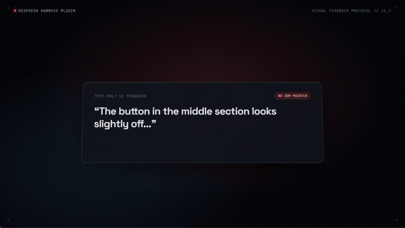

# dsh-redline

[English](README.md) · [Português (Brasil)](README.pt-BR.md) · [简体中文](README.zh-CN.md) · Русский

[](https://www.npmjs.com/package/dsh-redline) [](https://www.npmjs.com/package/dsh-redline) [](LICENSE) [](https://github.com/klaus-2/dsh-redline/releases) [](https://github.com/klaus-2/dsh-redline/discussions)

**Наведите на любой элемент страницы. Агент правит код.**

`dsh-redline` — плагин визуальной обратной связи и дизайн-ревью для [DeepSeek Harness](https://github.com/deepseek-ai/deepseek-harness): как комментарии в Figma или Vercel Toolbar, только отзыв уходит напрямую вашему кодовому агенту. Выберите элемент, оставьте комментарий, поправьте стили вживую и подтвердите — аннотации уходят агенту структурным контекстом, приложенным к следующему сообщению, вместе с обрезанным скриншотом ровно размеченной области.

`dsh plugin --profile web add dsh-redline`

---

## Зачем это

Описать проблему интерфейса словами — потерять указатель. «Кнопка в средней секции выглядит не так» заставляет агента угадывать. Redline держит отзыв привязанным к элементу: селектор, роль, текст, ваш комментарий, обрезанный скриншот и все опробованные правки стилей — одним структурным блоком, с которым агент может работать.

## Экскурсия по продукту



<sub>[Смотреть полное промо-видео 720p HD (MP4)](docs/assets/promo.mp4)</sub>

1. Нажмите **C** (комментарий) или **V** (стили) на любой странице, открытой в браузере Harness.
2. Кликните по элементу. Рядом с ним откроется поповер.
3. Напишите комментарий или откройте инспектор и поправьте текст, цвета, типографику, размеры, отступы, рамки и эффекты — каждое изменение сразу видно на странице.
4. Подтвердите. Карточка над полем ввода собирает ваши метки. Отправьте — и аннотации придут агенту снимком вместе с сообщением, отрисованные строкой Redline в чате.
5. Нажмите **D** для свободного холста аннотаций: кисть, линии, стрелки, прямоугольники, эллипсы, нумерованные шаги и текст — отправьте страницу в чат, и все рисунки войдут в скриншот.

## Что получает агент

Для каждой метки — один блок в общем снимке:

- `Target` — тег, роль, доступное имя
- `Target selector` — CSS-путь к элементу
- `Target text` / `Component` — содержимое и подсказки о фреймворке
- `Screenshot (cropped around the target)` — JPEG размеченной области с окружающим контекстом
- `Comment` — что вы попросили
- `Requested visual changes` — каждая живая правка как `prop: before -> after`
- `Requested text change` — если вы отредактировали текст элемента

## Возможности

- Выбор элементов с подсветкой при наведении на любой странице браузера Harness
- Комментарии к каждой метке, редактируемые на месте, с действиями «Закрыть», «Вернуть» и «Удалить»
- Живой инспектор стилей с откатом: перетаскивание чисел, выбор цвета, пресеты, связанные правки box-model и радиуса, компоновка теней и трансформаций, сброс строки
- Подсказки дизайн-токенов в инспекторе: предлагается собственный `var(--token)` страницы, если его вычисленное значение совпадает с правимым
- Экспорт CSS-патча: подтверждённые правки рендерятся копируемым правилом `selector { prop: value; }` в оверлее и блоком `Requested CSS:` в контексте агента
- Кнопка копирования селектора в поповере метки: селектор кладётся в буфер как есть
- Перепривязка устаревшей метки: когда целевой элемент исчезает из DOM, метка помечается, поповер предупреждает, а перетаскивание маркера привязывает её заново
- Цепочка предков в поповере: предки цели до `<body>` выводятся кликабельными чипами — клик перепривязывает метку (маркер и панель) к этому контейнеру
- Поповер метки показывает живые размеры цели (W×H px), а при исчезнувшем элементе — размеры из сохранённого снимка
- Пузырь метки предупреждает, если селектор совпадает с несколькими элементами, и показывает их число.
- Дублирование метки: комментарий и правки переносятся на другой элемент.
- Режим фокуса приглушает страницу и оставляет выбранный элемент интерактивным; Esc выходит.
- Темы оверлея: тёмная (по умолчанию), светлая и высококонтрастная — выбираются в настройках плагина и сохраняются
- Отмена и повтор в инспекторе: Ctrl+Z / Ctrl+Shift+Z (или кнопки панели) откатывают и возвращают непринятые правки и текст, пока панель открыта
- Ластик и отмена с клавиатуры: на холсте появляется ластик, удаляющий рисунок под курсором (кликом или протягиванием), а Ctrl+Z / Ctrl+Shift+Z / Ctrl+Y отменяют и повторяют рисунки, пока холст открыт (когда фокус не в поле ввода)
- Клик по метке в карточке чата прокручивает страницу к её элементу и на миг подсвечивает его
- Вставка изображения в комментарий: оно уменьшается (до 1600 px, JPEG), показывается как съёмный чип и уходит с меткой, чтобы агент его прочитал
- Скриншоты «до/после» для каждой исправленной метки: кадр «после» снимается на лету, затем страница восстанавливается и кадр «до» снимается уже с восстановленной страницы
- Групповые комментарии: режим группы на панели собирает N элементов и отправляет один комментарий, скопированный в каждую метку (в пределах страницы — группы не пересекают страницы)
- Шаблоны комментариев вставляют готовую фразу в поле ввода одним кликом.
- Пресеты адаптивного превью: страница ограничивается 375/768/1280 px или сбрасывается на всю ширину; метки, созданные при пресете, запоминают его ширину (учтите: единицы `100vw` и `position: fixed` не подчиняются ограничению)
- Сетка макета: кнопка на панели включает неинтерактивные полосы колонок поверх страницы (поля 32 px, промежутки 24 px); повторный клик открывает счётчик колонок (1–24), клик снаружи или Esc закрывает счётчик, а сетка остаётся, и при изменении окна полосы пересчитываются
- Измерение расстояний по Alt: удерживайте Alt с открытой панелью стилей или меткой — страница покажет пунктирные направляющие от этой точки до элемента под курсором, обводя оба элемента; отпустите Alt, и всё исчезнет
- Состояния в инспекторе (только предпросмотр): чипы :hover / :focus / :active в панели стилей включают эти состояния на цели страницы эмуляцией — класс-маркер и одна таблица стилей с переписанными правилами, без настоящего focus() — так hover, focus и active можно увидеть до применения; переписываются только правила, у которых последний составной селектор несёт псевдокласс (`.menu:hover .item` и :focus-within пропускаются), а класс-маркер может немного повысить специфичность
- Аудит доступности в поповере метки и по всей странице с группировкой по типу проверки.
- Быстрые исправления повышают контраст текста и добавляют alt изображению, с предпросмотром до подтверждения.
- Закрываемое уведомление на странице подтверждает копирование и действия закрытия/удаления; карточка чата показывает встроенное уведомление об экспорте отчёта и массовых результатах.
- Экспорт отчёта об ожидающих: скачайте ожидающие аннотации как Markdown или JSON из карточки ожидающих (доступ по секрету, только ожидающие)
- Предпросмотр точного контекста, изображений и комментариев, которые уйдут агенту.
- Обрезанные скриншоты для каждой метки (не весь вьюпорт)
- Выбор нескольких меток в карточке и массовые «закрыть»/«удалить».
- Аннотации прикрепляются к следующему сообщению сессии, которую вы смотрите, отрисовываясь одной строкой Redline, которая забирает сообщение (общий блок раскрытия контекста заменяется, а не дублируется), и строка переживает перезагрузку сессии
- Удаление метки из карточки убирает её и из оверлея страницы; закрытая метка сохраняется и помечается как закрытая.
- English, Português (Brasil), 简体中文 и русский в интерфейсе оверлея — язык выбирается по языку браузера

## Установка

```bash
dsh plugin --profile web add dsh-redline
dsh web
```

Для приватной или неопубликованной сборки установите из git-URL или локального пути:

```bash
dsh plugin --profile web add git+https://github.com/klaus-2/dsh-redline.git
dsh plugin --profile web add ./dsh-redline
```

## Использование

| Клавиша | Действие |
| --- | --- |
| `C` | Режим комментария — выберите элемент и напишите, что поменять |
| `V` | Режим стилей — выберите элемент и откройте живой инспектор стилей |
| `D` | Свободный холст — рисуйте поверх страницы и отправьте вместе со скриншотом |
| `H` | Показать или скрыть метки — маркеры, поповеры и поле комментария исчезают, панель остаётся |
| `Esc` | Отменить текущий режим, поповер или предпросмотр |
| `Enter` | Сохранить аннотацию из поповера |
| `Ctrl/Cmd+Enter` | Сохранить комментарий в открытом поповере метки |

Любую из трёх клавиш режима можно изменить в настройках плагина, и комбинация может нести модификаторы: `Ctrl+Shift+A` — тоже комбинация. Модификаторы должны совпадать точно — `Ctrl+A` не сработает для комбинации `Ctrl+Shift+A`, а простая клавиша не сработает при зажатом модификаторе. Два режима не могут делить одну комбинацию: настройки отклоняют вторую.

Поскольку модификаторы должны совпадать точно, `Shift+C` больше не входит в режим комментария: `Shift` — такой же модификатор, так что комбинация, срабатывающая с зажатым Shift, — `Shift+C`.

Комбинации сопоставляются с клавишей, которую сообщает клавиатура, а на нелатинской раскладке работает и физическая клавиша: с русской раскладкой клавиша `С` (физическая `C`) включает режим комментария.

Метки собираются в карточке над полем ввода. **Отправить** отправляет их вместе со следующим сообщением; ✕ отбрасывает, а оверлей страницы обновляется сам.

## Безопасность

Локальный сервер слушает только 127.0.0.1, отвечает только своим именам хоста (поэтому имя, разрешающееся в 127.0.0.1, не сможет до него достучаться) и проверяет заголовок Host, так что удалённые источники до него не доберутся. Каждый приватный маршрут требует секрет экземпляра, который хост хранит в профиле (`~/.dsh/profiles/<profile>/dsh-redline/instance.secret`, режим 0600) и который никогда не попадает на страницу: в оверлее нет ни секрета, ни заголовка, ни секрета в URL.

Вместо этого страница общается с хостом через ограниченный мост сообщений. Он может отправлять аннотации, сохранять рисунки, читать узкое состояние, которое рисует оверлей (язык, доставка, id ожидающих, настройки), и сообщать диагностику — на любой другой маршрут отвечает `401`. Хостовая половина зовёт мост с секретом; страница зовёт его из браузерного запроса, несущего этот origin, а заголовок `Origin` скрипт подделать не может. Этот же origin несут страницы, которые проксирует плагин, поэтому мост — канал аннотаций и никогда не канал данных.

Страница больше не получает текст ревью во встроенном конфиге и не хранит рисунки в Web Storage; хранилище рисунков хоста, защищённое секретом, — единственное хранилище рисунков. Неотправленные рисунки живут только в памяти и не переживают перезагрузку, метки остаются в пределах вкладки, а встроенная защита вычищает устаревшие ключи ревью из Web Storage до загрузки оверлея.

Страницы в браузере Harness могут отправлять аннотации по замыслу — так плагин и работает, поэтому относитесь к комментариям из Redline как к любому пользовательскому вводу: комментарий — это текст, который оверлей Redline захватил на странице, а ожидающие аннотации видны в карточке над полем ввода до прикрепления к следующему сообщению. Служебная лента агента (аргументы инструментов, текст агента) остаётся в хосте; страница всегда видит только узкую проекцию выше. Через прокси не передаются куки.

## Настройка

Плагин поднимает локальный сервер (`127.0.0.1:47477`, со сдвигом до следующих 20 портов), который отдаёт оверлей, вложения скриншотов и приём аннотаций.

Четыре клавиши режимов (комментарий, стили, холст, скрыть метки) — единственная настройка комбинаций: откройте настройки плагина и измените клавишу комментария, стилей или холста — клавиша скрытия меток сохраняется при каждом сохранении, и её можно править напрямую в `~/.dsh/redline/settings.json`. Комбинация может нести модификаторы (`Ctrl+Shift+A`), модификаторы должны совпадать точно, и два режима не могут делить одну комбинацию.

Тема оверлея — тоже настройка: тёмная (по умолчанию), светлая или высококонтрастный вариант тёмной палитры. Она применяется на странице сразу и переживает перезагрузки и перезапуски.

## Как это работает

Клиентская часть внедряет оверлей на каждую страницу, которую рендерит браузер Harness. Оверлей отправляет аннотации через мост сообщений, а локальный сервер хранит ожидающий снимок с ключом сессии, которую вы смотрите. Когда вы отправляете сообщение, хост прикрепляет снимок к ходу агента как контекстное сообщение производителя, чей `source` несёт структурные метки, а чат рисует его через API узлов разговора одной строкой Redline — со сворачиваемыми секциями — вместо общего блока раскрытия контекста.

## Разработка

```bash
npm run build
npm test
npm run strip-comments
```

Зависимостей устанавливать не нужно — плагин на чистом Node.js.

`overlay.template.js` + `tencil-overlay.css` — исходники; `lib/overlay.js` генерируется — никогда не правьте его напрямую. `npm run strip-comments` показывает, что изменит вырезальщик комментариев в поставляемых исходниках; добавьте `-- --write`, чтобы применить. Лицензии и копирайты в JS и CSS сохраняются; режим записи также удаляет контрактные и защитные заметки, описанные в `CONTRIBUTING.md`, так что это осознанная правка, а не форматтер. `tools/smoke.mjs` прогоняет прокси, переписывание HTML/CSS, приём аннотаций, сохранение обрезанных скриншотов, формат контекста и целостность оверлея на изолированном порту и во временном домашнем каталоге; `tools/regression.mjs` добавляет наборы хоста, клиента и пакета и печатает число проверок.

## Область применения

Один экземпляр Harness, страницы, отрисованные его встроенным браузером, обрезка по вьюпорту. Удалённые браузеры и полноэкранный захват пока вне области.

## Благодарности

### Содержит код из

- **[tencil](https://tencil.dev/)** — дизайн-система оверлея в
  `tencil-overlay.css` произведена от исходников оверлея tencil
  (Copyright 2026 Pixel Perfect Agency, лицензия Apache-2.0, изменено:
  акцентная палитра, удаление комментариев, дополнения инспектора).
  Полное уведомление: [THIRD-PARTY-NOTICES.md](THIRD-PARTY-NOTICES.md).

- **[html2canvas](https://html2canvas.hertzen.com/)** — `vendor/html2canvas.min.js`
  включает версию 1.4.1 (Copyright 2022 Niklas von Hertzen, MIT), чтобы
  рендерить обрезанные скриншоты без зависимостей при установке.
  Полное уведомление: [THIRD-PARTY-NOTICES.md](THIRD-PARTY-NOTICES.md).

### Вдохновлено

- **[dsh-web-review](https://github.com/CanglongCl/dsh-web-review)** —
  цикл доставки (аннотации прикрепляются к следующему сообщению агента).
- **[dsh-annotate](https://github.com/BrambleXu/dsh-annotate)** —
  форма структурных фактов о браузере и шаблон проверки обновлений.

## Лицензия

[MIT](LICENSE)
