# dsh-redline

[English](README.md) · [Português (Brasil)](README.pt-BR.md) · 简体中文

[](https://www.npmjs.com/package/dsh-redline) [](https://www.npmjs.com/package/dsh-redline) [](LICENSE) [](https://github.com/klaus-2/dsh-redline/releases) [](https://github.com/klaus-2/dsh-redline/discussions)

**指向页面上的任意元素，你的智能体直接改代码。**

`dsh-redline` 是 [DeepSeek Harness](https://github.com/deepseek-ai/deepseek-harness) 的插件，把可视化评审放进 harness 浏览器：选中元素、写批注、实时调整样式并确认——批注会作为结构化上下文附加到你的下一条消息，并附带精确裁剪的截图。

```
dsh plugin --profile web add dsh-redline
```

## 为什么做这个

用文字描述 UI 问题会丢失指针。"中间那一段的按钮看起来不对"只能让智能体去猜。Redline 把反馈绑定到元素本身：选择器、角色、文本、你的评论、裁剪截图，以及你尝试过的每一项样式调整——一次性放进智能体可以直接处理的结构化块里。

## 使用方式



1. 在 harness 浏览器打开的任意页面按 **C**（评论）或 **V**（调整）。
2. 点击元素，弹出的面板会锚定在元素上。
3. 写评论，或打开检查器实时调整文本、颜色、排版、尺寸、间距、边框和效果——每次修改都会在页面上即时预览。
4. 确认后，composer 上方的卡片收集你的 pin；发送时，标注作为快照随消息一起送达智能体，并在聊天中原生渲染。
5. 按 **D** 打开自由批注画布：画笔、直线、箭头、矩形、椭圆、编号步骤标记和文字——把整页发送到聊天，每个绘图都会合成进截图。

## 智能体收到什么

每个 pin 在单个快照中对应一个块：

- `Target` — 标签、角色、无障碍标签
- `Target selector` — 指回该元素的 CSS 路径
- `Target text` / `Component` — 内容与框架提示
- `Screenshot (cropped around the target)` — 标记区域及其周边上下文的 JPEG
- `Comment` — 你要求的内容
- `Requested visual changes` — 每一项实时调整，格式为 `prop: before -> after`
- `Requested text change` — 当你编辑过元素的文本时

## 功能

- 在 harness 浏览器渲染的任意页面上拾取元素并悬停高亮
- 每个 pin 的评论可就地编辑，支持解决/重新打开/删除
- 带回滚的实时样式检查器：拖拽数值、取色器、预设、联动盒模型与圆角、阴影与变换，逐行重置
- 每个 pin 独立裁剪截图（不是整个视口）
- 标注附加到当前查看会话的下一条消息，在聊天中原生渲染为卡片
- 对账同步：在卡片里移除一个 pin，也会把它从页面浮层中移除
- 浮层界面支持 English / Português (Brasil) / 简体中文，按浏览器语言自动选择

## 安装

```bash
dsh plugin --profile web add dsh-redline
dsh web
```

对于私有或未发布的构建，可以从 git URL 或本地路径安装：

```bash
dsh plugin --profile web add git+https://github.com/klaus-2/dsh-redline.git
dsh plugin --profile web add ./dsh-redline
```

## 使用

| 按键 | 动作 |
| --- | --- |
| `C` | 评论模式 — 选中一个元素，写下应该改变什么 |
| `V` | 调整模式 — 选中一个元素，打开实时样式检查器 |
| `D` | 自由画布 — 在页面上作画，连同截图一起发送 |
| `Esc` | 取消当前的模式、弹出面板或预览 |
| `Enter` | 保存弹出面板中的批注 |

三个模式按键都可以在插件设置里改，快捷键也可以带修饰键：`Ctrl+Shift+A` 同样算一个快捷键。修饰键必须完全一致——`Ctrl+A` 不会触发配置为 `Ctrl+Shift+A` 的快捷键，按住修饰键时普通按键也不会触发。两个模式不能共用同一个快捷键，设置会拒绝第二个。

因为修饰键必须完全一致，`Shift+C` 不再进入评论模式：`Shift` 和其他修饰键一样，所以按住 Shift 时触发的是 `Shift+C`。

pin 会在 composer 上方的卡片里收集。**发送**会把它们随你的下一条消息一起分发；✕ 则丢弃它们，页面浮层会自行更新。

## 安全说明

环回服务器只绑定 127.0.0.1，只应答自己的主机名（因此解析到 127.0.0.1 的名字无法触达它），并校验 Host 头，因此远程来源无法触达它。每条私有路由都要求一个实例密钥，由主机保存在 profile 里（`~/.dsh/profiles/<profile>/dsh-redline/instance.secret`，权限 0600），且密钥永远不会到达页面：浮层不持有密钥、不持有头部，URL 里也没有密钥。

页面改为通过一条受限的消息桥接与主机通信。它可以提交批注、保存绘图、读取浮层绘制的窄状态（语言、投递、待发送 id、设置）并上报诊断——其余所有路由都返回 `401`。主机一侧带着密钥调用桥接；页面一侧则从携带本来源的浏览器请求调用它，而 `Origin` 头无法被脚本伪造。这个来源同时也承载插件代理的页面，因此桥接是批注通道，绝不是数据通道。

页面不再在内联配置里收到评审文本，也不再往 Web Storage 里存绘图；主机那个由密钥保护的绘图存储是已保存绘图的唯一存放处。未发送的绘图只存在于内存中，刷新后即消失；pin 只在当前标签页内有效；浮层加载之前，一条内联守卫会从 Web Storage 中清除遗留的评审键。

在 harness 浏览器里运行的页面本来就可以提交批注——这是插件按设计在工作，因此要把通过 Redline 送达的评论当成任何其他用户输入来对待：评论是 Redline 浮层在页面上捕获的文本，待发送的批注在附加到你的下一条消息之前会显示在 composer 上方的卡片里。智能体的滚动信息条（工具参数、智能体文本）留在主机一侧；页面只能看到上面那条窄投影。代理不转发任何 cookie。

## 配置

插件会启动一个环回服务器（`127.0.0.1:47477`，失败则依次尝试后续 20 个端口），用于提供浮层、截图附件和批注接收。

三个模式按键是唯一的设置：打开插件设置，修改评论、调整或画布按键。快捷键可以带修饰键（`Ctrl+Shift+A`），修饰键必须完全一致，且两个模式不能共用一个快捷键。

## 工作原理

聊天侧的客户端把浮层注入 harness 浏览器渲染的每一页。浮层通过消息桥接发送批注，环回服务器按你正在查看的会话保存一份待发送快照。当你发送消息时，主机把这份快照作为生产者拥有的上下文消息（带分节元数据）附加到智能体的回合，聊天界面将其渲染为一张可折叠的卡片。

## 开发

```bash
npm run build
npm test
npm run strip-comments
```

没有依赖需要安装——插件是纯 Node.js。

`overlay.template.js` + `tencil-overlay.css` 是源文件；`lib/overlay.js` 由构建生成，请勿直接修改。`npm run strip-comments` 会报告注释清理器会对已发布的源文件做哪些改动；加上 `-- --write` 即可应用。许可证与版权声明在 JS 和 CSS 源文件中保留；write 模式也会移除 `CONTRIBUTING.md` 里描述的契约与安全注释——所以它是一次刻意的编辑，不是格式化工具。`tools/smoke.mjs` 在隔离端口和临时 home 下演练代理、HTML/CSS 重写、批注接收、裁剪截图持久化、上下文格式和浮层完整性；`tools/regression.mjs` 再加上 host、client 与 package 套件，也是唯一打印 check 计数的那个。

## 范围

一个 harness 实例、由它内置浏览器渲染的页面、基于视口的裁剪。远程浏览器与整页截图暂时不在范围内。

## 致谢

### 包含来自以下项目的代码

- **[tencil](https://tencil.dev/)** — `tencil-overlay.css` 中的浮层设计系统衍生自
  tencil 的浮层源码（Copyright 2026 Pixel Perfect Agency，Apache-2.0 许可，
  修改内容：强调色板、注释移除、检查器扩展）。
  完整声明：[THIRD-PARTY-NOTICES.md](THIRD-PARTY-NOTICES.md)。

- **[html2canvas](https://html2canvas.hertzen.com/)** — `vendor/html2canvas.min.js`
  打包了 1.4.1 版本（Copyright 2022 Niklas von Hertzen，MIT），用于在没有任何
  安装期依赖的情况下渲染截图裁剪。
  完整声明：[THIRD-PARTY-NOTICES.md](THIRD-PARTY-NOTICES.md)。

### 灵感来源

- **[dsh-web-review](https://github.com/CanglongCl/dsh-web-review)** —
  投递闭环（批注附加到智能体的下一条消息）。
- **[dsh-annotate](https://github.com/BrambleXu/dsh-annotate)** —
  结构化 browser-facts 的形态与更新检查模式。

## 许可

[MIT](LICENSE)
